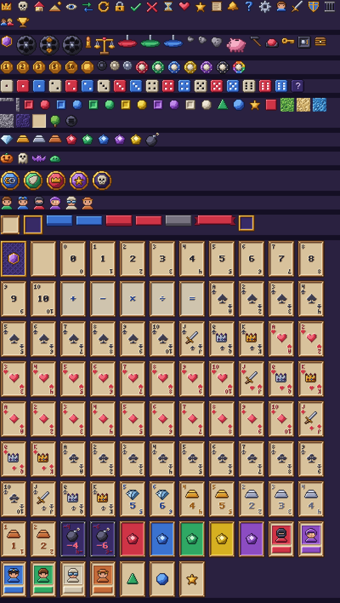

# Pieces & Prisons

A collection of strategy, deduction and bluffing party games inspired by Korean "brain survival" game shows. Players earn **Pieces**, avoid **prison**, and outplay each other one match at a time.

> **Status:** pre-production. The art assets and research notes are done. The games themselves come next.



## What's here

| Path | What |
|---|---|
| `assets/sprites/` | 231 pixel-art sprites at 1x, one PNG each, grouped by category |
| `assets/sprites@4x/` | The same sprites upscaled 4x for docs and previews |
| `assets/sheets/` | Packed sprite sheet plus JSON atlas for each category (for the game client) |
| `assets/manifest.json` | Every sprite with its size and description |
| `assets/palette.json` | The material colour ramps |
| `assets/preview.html` | Visual gallery (open it locally) |
| `tools/pixelkit.py` | A small pixel-art engine: parts, auto-shading, sel-out outlines |
| `tools/build_assets.py` | Every sprite definition; rebuilds all of the above |
| `docs/game-catalog.md` | Research notes: game mechanics and rules to adapt |
| `docs/art-style-guide.md` | Art direction and rules |
| `docs/asset-inventory.md` | Auto-generated list of every sprite |

## Asset categories

- **Cards** (95): a full 52-card deck, number cards 0–10, operator cards, gem and bomb cards, colour cards, hidden-role cards, shape cards, and a card back.
- **Coins and chips** (16): gold coins worth 1/2/3/5/10, black, white and silver coins, and betting chips in 6 colours plus a rainbow chip.
- **Dice** (19): white, red and blue dice with faces 1–6, plus a hidden die.
- **Items** (18): the Piece, a revolver cylinder, a bullet, a balance scale and scale pans, rocks, a piggy bank, a wall breaker, a push button, a key, a safe and a treasure chest.
- **Board** (26): wall segments, square and round counters, bingo shapes, terrain tiles, a tree and a manhole.
- **Gems** (10): a diamond, gold, silver and copper ingots, 5 cut gems, and a bomb.
- **Tokens** (5): Alliance, Salvation, Prize, Victory and Curse medallions.
- **Portraits** (6): chibi role portraits.
- **Icons** (23): UI icons such as crown, skull, prison, house, exile, eye, swap, timer, lock and more.
- **Monsters** (4) and **UI** (9): panels, buttons, a ribbon and an item slot.

## Rebuild the assets

```bash
pip install pillow
python3 tools/build_assets.py
```

## Note on originality

Every game here is an original implementation of a general mechanic: auctions, bluffing, deduction, area control, and so on. All art is original.

This project is not affiliated with, endorsed by, or using material from any TV show, streaming service or game studio. The research notes in `docs/` describe mechanics in our own words for design reference only.
