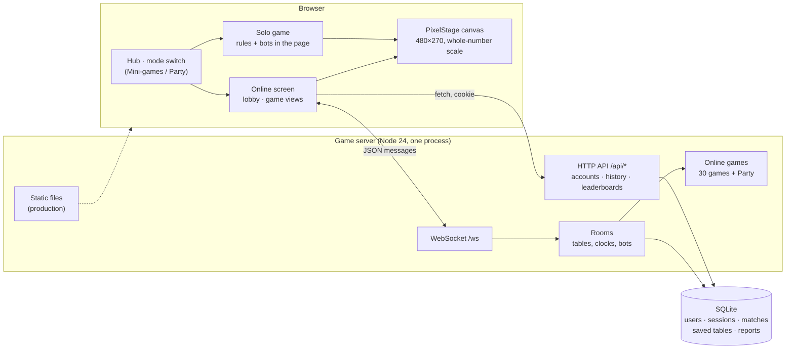
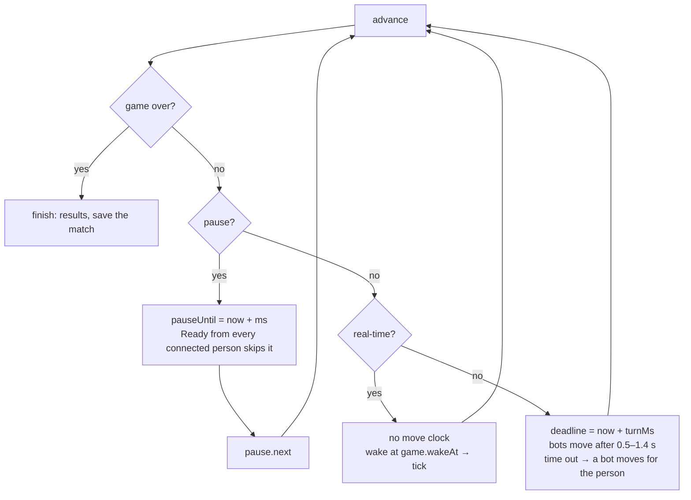

# Architecture

How Pieces & Prisons works, from the sprites to the server. Read this first if you're new to the code; the other docs go deeper on one part each.

| Doc | What |
|---|---|
| [README](../README.md) | What the project is, how to run it, how to host it |
| **architecture.md** (this) | How the pieces fit together |
| [online-plan.md](online-plan.md) | How each game went online, the rules for hiding secrets, and server work done |
| [party-mode.md](party-mode.md) | Party mode: rules, mini-games, clocks, screen |
| [art-style-guide.md](art-style-guide.md) | Pixel-art rules |
| [asset-inventory.md](asset-inventory.md) | Every sprite (generated) |
| [game-catalog.md](game-catalog.md) | Research notes on the mechanics the games adapt |

---

## 1. The big picture



- **One repository, two halves.** `app/src` is the web app (React + TypeScript + Canvas, built with Vite). `app/server` is the game server (Node 24, run with `tsx`). They share code: the server imports each game's rules straight from `app/src/games`.
- **Every game's rules are pure TypeScript** (`logic.ts`), with no drawing and no network. The solo screen, the bots, the tests and the online server all call the same functions.
- **Solo play needs no server.** The page runs the rules and the bots itself. Accounts, online tables, Party mode, match history and leaderboards need the server.
- **Online, the server is the referee.** It holds the real game state, applies every move and sends each player only what that player is allowed to see.
- **One process, one origin.** In production the game server also serves the built web app, so the page, `/api` and `/ws` share one HTTPS origin, and the session cookie and WebSocket origin check work without extra setup.

## 2. Repository layout

```
assets/              generated pixel art (sprites, sprite sheets, palette, manifest)
tools/               pixelkit.py (the pixel-art engine) and build_assets.py (every sprite)
docs/                these documents
Dockerfile, fly.toml hosting (Fly.io)
app/
  index.html         page shell (loads the DotGothic16 font)
  vite.config.ts     serves ../assets as static files; forwards /api and /ws to the server in development
  src/
    main.tsx, App.tsx  app shell and screen switching
    engine/          atlas.ts (sprite sheets), gfx.ts (drawing helpers), PixelStage.tsx (the canvas)
    ui/              Hub, AccountPanel, Online (tables + lobby), Records (history, leaderboards), RaceBoard, Panel
    net/             account.ts (HTTP API client), table.ts (WebSocket hook)
    games/
      registry.ts    the list of games shown on the hub
      shared/        rng.ts, pace.ts, race.ts, draw.ts — used by many games
      <game>/        logic.ts, bots.ts, <Game>.tsx, online.ts, <Game>Online.tsx, logic.test.ts
      party/         Party mode: logic.ts (board rules) and PartyOnline.tsx (board screen)
  server/
    index.ts         start-up, saving, shutdown
    app.ts           HTTP API
    ws.ts            WebSocket connections
    rooms.ts         online tables (the heart of multiplayer)
    games/           types.ts (the OnlineGame interface), catalog.ts (the 30 games), party.ts, index.ts
    auth.ts, names.ts, db.ts, persist.ts, stats.ts, static.ts
    admin.ts, loadcheck.ts   command-line tools
    *.test.ts        server tests
```

## 3. Assets and drawing

**Sprites are code.** `tools/build_assets.py` defines all 256 sprites with `tools/pixelkit.py`: each sprite is made of *parts* with a five-tone material ramp, shaded and outlined automatically. Running it writes:

- `assets/sprites/<category>/*.png` (1x) and `assets/sprites@4x/` (previews)
- `assets/sheets/<category>.png` + `.json`: one packed sheet per category, which the app loads
- `assets/manifest.json`, `assets/preview.html`, `docs/asset-inventory.md`, `docs/contact-sheet.png`

There are 12 categories: cards, coins, dice, items, board, gems, tokens, portraits, icons, monsters, ui and party. Add a category in `build_assets.py` **and** in `CATEGORIES` in `app/src/engine/atlas.ts`.

**Drawing.** Every game screen draws onto a `PixelStage` (`app/src/engine/PixelStage.tsx`):

- A canvas with a small logical size, usually **480×270**. It scales by the largest **whole number** that fits the container and the window height, so pixels stay crisp: 2x on most laptops, 3x on 1920-wide screens. On a phone it shrinks to the screen width.
- Each frame calls the screen's `draw(g)` with a `Gfx` object (`app/src/engine/gfx.ts`): `sprite`, `tile`, `panel` (9-slice), `rect`, `frame`, `text`, `button`, `hit`. Click areas are rebuilt every frame, and `onHit(id)` reports which one was clicked.
- Text is a real font (DotGothic16), so it stays sharp at any scale.
- DOM is used around the canvas for the hub, account forms, lobby, logs and records.

## 4. A game, in five files

Each game lives in `app/src/games/<game>/`:

| File | Role |
|---|---|
| `logic.ts` | The rules: a state type and pure functions (`newGame`, moves, scoring). Randomness comes in as a seeded `Rng`. |
| `logic.test.ts` | Rule tests (Vitest). |
| `bots.ts` | Computer opponents. They read only what a player could know. |
| `<Game>.tsx` | The solo screen: `drawScene(g, state)` plus a React component that runs the bots. Exports `RULES` for the rules dialog. |
| `online.ts` | The game at an online table: actions, `act` (checks every move), `view` (what a seat may see), `waitingOn`, `botAction`, `pause`, `over`, `results`. |
| `<Game>Online.tsx` | The online screen: reuses the solo `drawScene` with the server's view and sends moves. |

Shared helpers in `app/src/games/shared/`:

- `rng.ts`: a seeded generator (mulberry32) whose whole state is one number, so a running game can be saved and restored exactly.
- `pace.ts`: game speed (Fast / Normal / Slow). Bot pauses and reveals go through `pace()`, but only games marked `paced` in the registry show the setting.
- `race.ts`: turns any solo puzzle into a **puzzle race** (everyone gets the same puzzle; the server keeps the answer, checks submissions and times everyone). The seven exile and hidden-stage puzzles use it.
- `draw.ts`: common overlays (standings panel, star counts).

`app/src/games/registry.ts` lists every game: name, tagline, stage (prison, main, exile, final, hidden), player count, icon, and the `memory` and `paced` flags. `memory` games show no log or deduction aids, because remembering is part of the game.

## 5. The web app

`App.tsx` switches between screens with a single `current` value (no URL routes):

- `null` → **Hub** (`ui/Hub.tsx`): account panel, Leaderboards link, and the **Mini-games / Party** switch (remembered in `localStorage`). Mini-games shows every game by stage; Party shows the rules and a button.
- a game id → that game's **solo screen**, loaded on demand (`GAME_VIEWS` uses dynamic `import()`, so the first download is about 180 kB), with the rules dialog, bot count and speed.
- `'online'` → **Online tables** (`ui/Online.tsx`): start a table for any game, or join one by code.
- `'party'` → the same Online screen in party mode: "Start a party" plus join by code.
- `'matches'`, `'leaders'` → **My matches** and **Leaderboards** (`ui/Records.tsx`).

Inside Online, `useTable()` (`net/table.ts`) keeps the WebSocket. When a table is playing, the screen shows the game's online view from `ONLINE_VIEWS` (each loaded lazily with `React.lazy`). Each view gets `{ game, room, send, onAgain, error }`.

## 6. Accounts and privacy

Players give **no personal details**:

- An **account** is a username (3–16 letters, digits, `_` or `-`) and a password. No email, so a forgotten password can't be recovered.
- A **guest** is just a name. A guest can later add a username and password ("upgrade") and keep their history.
- Names are checked by `server/names.ts`: slurs are refused anywhere in a name (however disguised), shorter ambiguous words only as the whole name, and staff-like names ("admin") are refused. Players can report a name at a table; `server/admin.ts` lists and resolves reports and renames players.

Security (`server/auth.ts`, `server/app.ts`, `server/ws.ts`):

- Passwords are hashed with **scrypt** and a random salt.
- Sessions are a random token in an **HttpOnly, SameSite** cookie (`pp_session`, `Secure` in production). The database keeps only the token's SHA-256 hash. Accounts stay signed in 30 days, guests 7.
- POSTs must be `application/json`, which together with SameSite cookies blocks cross-site form posts.
- Rate limits: 20 sign-in-type requests per address per 10 minutes, and 8 wrong passwords per username per 15 minutes. Behind Fly's proxy the real address comes from `CLIENT_IP_HEADER`.
- The WebSocket accepts only signed-in players whose `Origin` matches the host, checks the session again on every message, closes a connection that sends a message over 4 KB, and ignores more than 20 messages a second.

**HTTP API** (`server/app.ts`, JSON in and out):

| Request | Does |
|---|---|
| `GET /api/me` | Who am I, and the table I'm seated at (for *Rejoin table*) |
| `GET /api/matches` | My finished matches, newest first |
| `GET /api/leaderboard?game=<id>` | Top players for a game, or all games |
| `GET /api/health` | Health check for the host |
| `POST /api/signup` · `/api/login` · `/api/guest` | Sign in; sets the cookie |
| `POST /api/upgrade` | Guest → account |
| `POST /api/logout` · `/api/delete` | Sign out · delete my account |

## 7. Online tables

### The OnlineGame interface

`app/server/games/types.ts` defines how any game plugs into a table:

```ts
interface OnlineGame<S> {
  id, minPlayers, maxPlayers
  start(seats, rng, now): S
  act(state, seat, action, now): S          // throws a friendly message if the move isn't allowed
  view(state, seat | null, now): unknown    // only what this seat may see
  waitingOn(state): string[]                // seats that must move now
  botAction(state, seat, rng): unknown
  turnMs?(state): number                    // time for this decision (default 60 s)
  decisionKey?(state): string               // moves within one decision don't restart the clock
  pause?(state): { ms, next(state, now) } | null   // e.g. a result on screen
  over(state): boolean
  results(state): { seat, place, detail }[]
  realtime?: { wakeAt, tick, dropped, takeover }   // games where timing matters
}
```

`server/games/catalog.ts` wraps each game's `online.ts` into an `OnlineGame` (the 30 games). `server/games/index.ts` adds the Party on top: `ONLINE_GAMES = { ...CATALOG, party: partyGame(CATALOG) }`.

### Rooms: the table engine

`server/rooms.ts` runs every table in memory. A table has a four-letter code (no I or O), a host, seats (people or bots), a status (`lobby` → `playing` → `over`), the game state and its own seeded `Rng`.

**Messages** (JSON over `/ws`):

| Client → server | Server → client |
|---|---|
| `hello` (on every connect), `create {gameId}`, `join {code}`, `leave` | `room {room}` — seats, host, status, results |
| `addBot`, `removeSeat {seat}`, `start`, `again` (host) | `game {view, waiting, deadline, pauseUntil, now}` — this seat's view |
| `act {action}`, `ready` (skip a pause), `report {seat}` | `error {message}`, `left` |

**After every change** the room calls `advance()`:



Then it **broadcasts**: each seated person gets the room view and their own `game` message. Messages carry the server's `now`, so the page converts `deadline` and `pauseUntil` to its own clock and countdowns stay right even if the player's computer clock is off.

**Turn-based and real-time.** Most games are turn-based: the room asks `waitingOn`, starts the move clock and lets bots move. Real-time games (Sand Bid, Number Forge, Split Decision, the puzzle races) set `realtime`: the room skips the move clock, wakes the game when `wakeAt` says and calls `tick`. The game then times holds, answers and arrival order itself, and drives its bots.

**People coming and going:**

- Losing connection keeps the seat. Opening Play online again sends `hello`, which puts the player back.
- In the lobby a reloaded page keeps its seat (marked *away*) for 45 seconds.
- Leaving mid-game hands the seat to a bot (`takeover` for real-time games).
- A table nobody has been connected to for 10 minutes is closed.

**Hiding secrets.** Each game's `view` sends only what that seat's screen shows at that moment: no rival hands, hidden bids, answers or deck order, and for memory games nothing the player is meant to remember. The viewer usually appears as id `'you'`, so the solo drawing code works unchanged. Server tests check that secrets never appear in any message a player receives. See [online-plan.md §4](online-plan.md#4-rules-for-memory-games).

### Party mode

The Party (`server/games/party.ts`) is itself an `OnlineGame`, and it runs the other games *inside* itself:

- The board rules are pure functions in `app/src/games/party/logic.ts`: rolls, spaces, events, duels, the vault, payouts and standings.
- Its stages are `board` → `intro` → `mini` → `payout` → back to `board`, ending at `done`. Board decisions have a 30 s clock.
- A mini-game is a real `OnlineGame` from the catalog, started with only the seats that play it and shortened (one puzzle, fewer rounds). The Party passes the child's `realtime` ticks and pauses through, and drives turn-based children with its own per-seat timers (45 s for people, under 2 s for bots).
- Moves for a mini-game arrive as `{ type: 'mini', action }`. The client wraps the child's own online screen so its moves go through the Party (`PartyOnline.tsx`).
- A duel between two bots is played out at once on a pretend clock, so nobody waits on it.

Details: [party-mode.md](party-mode.md).

## 8. Data

One SQLite file (`app/data/pieces.db` locally, `/data/pieces.db` on Fly), opened with Node's built-in `node:sqlite` in WAL mode. `server/db.ts` runs numbered migrations and records progress in `PRAGMA user_version` (now 2).

| Table | Holds |
|---|---|
| `users` | id, username (accounts only, case-insensitive), display name, password hash (accounts only), timestamps |
| `sessions` | SHA-256 of the token, user, expiry |
| `matches` | game id, start and finish times |
| `match_players` | each seat's name, place and detail; `user_id` is empty for bots and seats a bot took over |
| `saved_tables` | running tables, saved for a restart |
| `reports` | name reports and whether they were resolved |

- **History and leaderboards** (`server/stats.ts`) read `matches` and `match_players`. Only real players count, and names are today's names.
- **Saving tables** (`server/persist.ts`): every 30 seconds and when the server stops, every table is encoded (seeded generators as their state, Maps, Sets and non-finite numbers in a tagged form) into `saved_tables`. On start-up they are restored and the clocks start afresh. A table that can't be encoded exactly isn't saved, so it's never restored half-broken.
- Expired sessions are swept every hour.

## 9. Running and hosting

**Development** (from `app/`): `npm run dev` (Vite, port 5173) and `npm run server` (game server on 8787, restarts on changes). Vite forwards `/api` and `/ws` to the server, so both share one origin.

**Production** is one container (`Dockerfile`, built from the repo root because the app needs `assets/`):

1. `npm ci`, then `npm run build`: type-check the app and the server, and build the web app into `app/dist`.
2. The runtime image keeps `dist`, `server`, `src` (the server imports the rules) and the production dependencies, and runs `tsx server/index.ts` as the unprivileged `node` user.
3. `NODE_ENV=production`: Secure cookies, and `dist/` served by `server/static.ts` (hashed files under `/assets` cached for a year).

**Fly.io** (`fly.toml`): app `pieces-and-prisons` in Amsterdam, **one always-on machine** (tables live in memory, so it must never sleep or run twice), a 1 GB volume at `/data` for the database (daily snapshots), health check on `/api/health`. A deploy stops the machine with SIGTERM: the server tells everyone it's restarting, saves every table and closes the database; the new machine restores the tables and pages reconnect by themselves. Steps and commands: [README → Hosting on Fly.io](../README.md#hosting-on-flyio).

**Capacity**: `npx tsx server/loadcheck.ts 150 60` runs busy bot tables. 150 tables used about 260 MB and 37% of one Mac core. The 512 MB Fly machine handles roughly 50 very busy tables, more with real players.

## 10. Tests

`npm test` runs Vitest over 63 files (433 tests):

- `app/src/games/*/logic.test.ts` (and Sand Bid's `round.test.ts`): rules, scoring, bots and edge cases for every game, plus the Party board.
- `app/server/*.test.ts`: accounts and the API, the name filter, saving and restoring, stats, static files, and for every online game what each seat can and can't see, invalid moves refused, and a whole match played to the end and recorded. `party.test.ts` covers table sizes, clocks, mini-games and a full 8-player party.

`npm run build` also type-checks the server (`tsconfig.server.json`).

## 11. Adding things

**A new online game:** write `logic.ts`, `bots.ts` and the solo screen; add `online.ts`; wrap it in `server/games/catalog.ts`; add `<Game>Online.tsx` and register it in `ONLINE_VIEWS` (`app/src/ui/Online.tsx`); add it to `GAME_VIEWS` (`App.tsx`) and `registry.ts`; write a server test that checks hidden information. The checklist is in [online-plan.md §2](online-plan.md#2-converting-a-game--the-checklist).

**A game as a Party mini-game:** add an entry to `MINIS` in `server/games/party.ts` with the player counts it supports, whether it fits rounds and/or duels, and a `short` function that cuts it down to a minute or two.

**A sprite:** define it in `tools/build_assets.py`, run `python3 tools/build_assets.py`, and draw it with `g.sprite(category, name, x, y)`.

**A database change:** append a migration to `MIGRATIONS` in `server/db.ts`. Never edit one that has already run.
